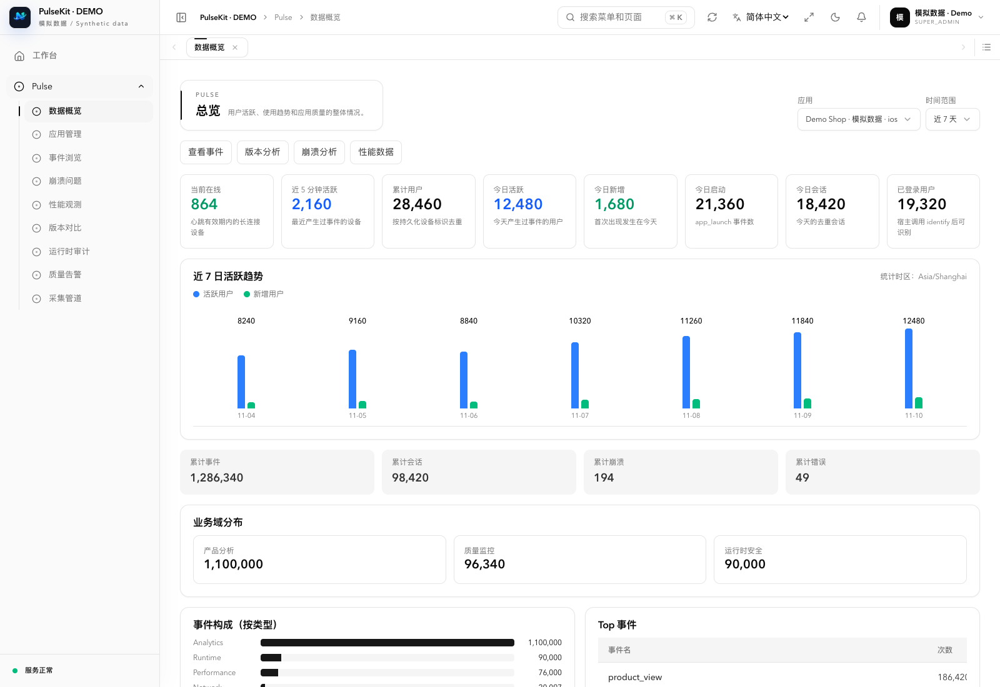
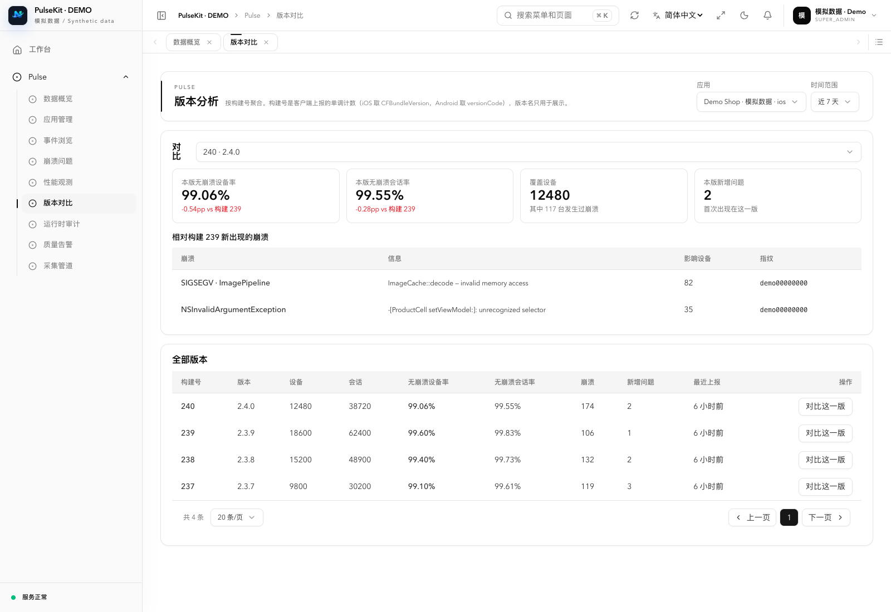
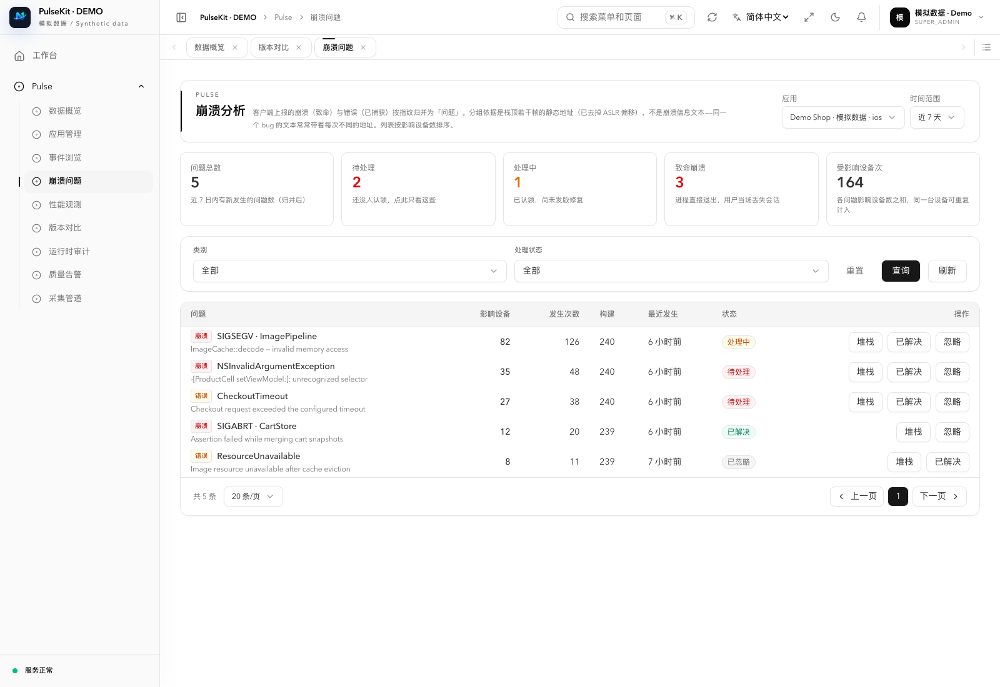
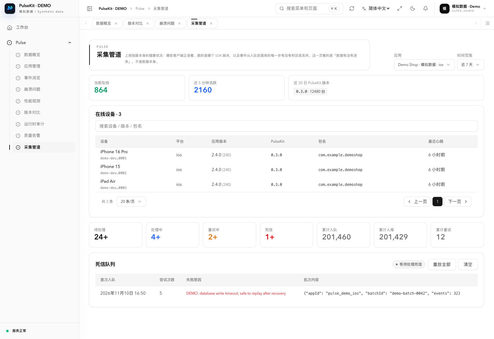

# PulseKit

**面向 iOS 与 Android 的开源应用统计、稳定性监控与运行时观测组件。**

PulseKit 对标友盟的应用统计与性能监控、Bugly 的崩溃分析与版本质量管理，将业务事件、应用会话、异常、性能和第三方 SDK 运行证据放在同一条数据链路中。开发者既能了解应用如何被使用，也能追踪一次崩溃发生在哪个版本、影响哪些设备，以及相关模块在运行时做了什么。

项目由 **PulseKit 客户端 SDK、Pulse 服务端模块和 Pulse 管理后台**组成，支持自建采集与分析环境。其重点是可控的数据链路、可扩展的源码和第三方 SDK 治理，而不是宣称已经完整替代友盟、Bugly 的所有商业产品。

> 本文依据 2026-11-10 查阅的 SDK 与服务端、前端模块源码整理。**已实现**表示存在对应实现，不代表所有平台均已完成生产验收；平台差异与未实现能力在下文单独列出。SDK 当前源码版本为 **0.3.1**。

## 产品定位

| 方向 | PulseKit 解决的问题 | 对标范围 |
| --- | --- | --- |
| 应用统计 Analytics | 有多少设备在使用？新增、启动和会话如何变化？用户触发了哪些业务事件？ | 友盟 U-App 的基础统计与事件分析 |
| 稳定性与性能 APM | 哪些崩溃重复出现？新版本是否退化？启动、主线程和内存是否异常？ | Bugly、友盟 U-APM 的质量监控 |
| 运行时观测 Runtime | 加载了哪些 SDK？哪个模块调用了敏感 API、权限入口或网络目的地？ | 第三方 SDK 治理与应用运行证据 |
| 版本与运维 | 哪个构建应提示更新？异常是否触发告警？采集积压能否重放？ | 自建应用质量管理与数据管道运维 |

适用于希望私有化部署、需要关联业务行为与稳定性问题、或需要核对第三方 SDK 与最终交付包的团队。宿主应用不必使用 Kotlin 编写：iOS 通过 Objective-C/Swift 接口接入，Android 提供 Java 接口。

## 核心能力

### 1. 应用统计与统一事件

- **自动生命周期采集**：会话、启动、前台与后台事件；Android 对旋转等配置变化做区分，避免产生伪前后台切换。
- **业务埋点**：通过 `track` 上报自定义事件及属性，通过 `identify` 关联宿主自己的业务用户 ID。
- **持久化身份**：设备 ID、安装 ID 与会话 ID，业务账号可选；不绑定宿主的登录或会员模型。
- **基础统计看板**：总设备数、已识别账号数、今日活跃设备、今日新增设备、会话、启动次数、每日趋势和热门业务事件。
- **统一事件分类**：Analytics、Crash、Error、Log、Network、Performance、Runtime、Breadcrumb，共用事件模型和会话关联字段。
- **事件检索**：按应用、事件类型、会话及时间范围查询，查看属性与运行上下文。

**统计口径**：当前概览中的匿名“用户”以持久化 `device_id` 去重，`identifiedUsers` 单独按业务 `user_id` 统计；新增指该应用数据中首次出现的设备，不能直接等同商店安装量。日报当前使用 `Asia/Shanghai`。尚未提供完整的跨端身份合并、留存、漏斗、用户路径与营销归因产品。

### 2. 崩溃、错误与版本质量

- **iOS 崩溃采集**：POSIX 信号与未捕获 Objective-C 异常；崩溃记录落盘后在下次启动补报。
- **Android 崩溃采集**：捕获未处理 Java 异常，保留异常类型、消息和堆栈，并继续调用平台原有异常处理器。
- **主动错误上报**：记录业务或框架捕获到的错误，不要求应用必须崩溃。
- **问题聚合**：按指纹归并崩溃，查看问题明细、出现记录、影响设备与处理状态。
- **堆栈辅助还原**：服务端支持符号表上传与地址解析、Android R8 mapping 还原；还原效果受构建匹配与符号完整度限制。
- **版本质量对比**：按 build number 统计设备、会话、崩溃、错误和新增问题，比较当前版本与基线版本的退化情况。
- **无崩溃率**：同时展示无崩溃设备率与无崩溃会话率，避免只用崩溃次数判断版本好坏。

当前 Android **不采集宿主原生 `.so` 的 Native Crash**；内存采样也不等于 OOM/FOOM 根因分析。不能将这些能力描述成与成熟商业崩溃平台完全等价。

### 3. 性能观测

- 自动记录应用启动耗时、主线程长时间无响应和内存占用。
- 支持主动上报耗时指标与数值指标，后台提供性能事件浏览。
- iOS 内存指标使用 `phys_footprint`，Android 使用 RSS；不同平台的数据口径需分别解释。
- 主线程 watchdog 用于发现挂起、卡顿迹象，不等同于完整的 Android 系统 ANR 诊断。
- 网络观测当前以 iOS 请求元数据和目的地为主，尚不是完整的 DNS/TCP/TLS/响应耗时分阶段网络 APM。

### 4. 第三方 SDK 与运行时观测

Runtime 为可选能力，默认不开启。它记录自身应用进程内可观测到的事实，帮助定位 SDK 行为和交付版本差异。

| 能力 | iOS | Android |
| --- | --- | --- |
| 加载模块清单 | 随包及后加载镜像、相对路径、Mach-O UUID | 安装范围内的映射模块；可读取的 ELF 使用 build-id，APK 直映射有粒度限制 |
| 隐私声明 | UsageDescription、主包/Framework Privacy Manifest、tracking 与 required-reason API 声明 | 合并后的 Manifest 权限及授权状态 |
| 签名信息 | 主程序 Code Signature、entitlements 关键字段 | 签名证书 SHA-256、密钥轮换、debuggable、安装来源 |
| 敏感 API 调用 | 已注册 Objective-C API 的调用及来源模块归因 | 尚未实现同等调用级观测 |
| 权限申请入口 | 定位、相册、相机、麦克风、通讯录、ATT 等已覆盖入口 | 当前以权限声明与状态清单为主 |
| 网络目的地 | `NSURLSessionTask.resume` 的目的地与请求元数据 | 尚未提供同等采集 |
| 方法与调用路径 | Objective-C 类/方法清单、调用点偏移、栈指纹和有界调用路径 | 无 Objective-C 方法清单，不做 ART 方法 hook |

iOS 的已覆盖观察点还包括剪贴板、IDFV/IDFA、UserDefaults、Cookie 与部分 WebView 桥接/脚本调用。网络元数据包含 method、去掉参数值的目的地、query/header 字段名、Content-Type 和 body 大小；**不把这些元数据描述为完整请求内容或数据泄露证明**。

采集边界：不上传 UserDefaults 的 key/value、Cookie 内容、WebView 脚本文本或权限回调内容；权限入口事件不代表最终授权结果。当前不覆盖所有纯 Swift、C/C++、Network.framework、CFNetwork 或 POSIX socket 调用，也没有完整的本地数据流追踪。自定义业务事件的属性仍需由接入方自行脱敏。

### 5. iOS 发布制品与运行证据关联

- 在版本管理中上传已签名 IPA 或压缩后的 XCArchive，静态解析二进制，不执行上传代码。
- 识别 thin/fat Mach-O、架构、LC_UUID、实际 `__TEXT` 段 SHA-256、动态依赖与导入符号。
- 提取可见的 Swift/C++/C 符号、Swift metadata 标记、签名证书及证书摘要。
- 将归档中的 dSYM 作为调试伴随文件处理；只有 **UUID 与架构匹配**才关联镜像。
- 按应用、构建和镜像 UUID 关联运行时敏感调用、网络目的地与方法清单，辅助识别同名二进制替换和模块漂移。
- 支持服务端模块规则、行为聚合及告警处置。

符号缺失或不匹配时明确保留未匹配状态，不靠文件名猜测。当前不解析 DWARF 行表，因此不承诺源码行号恢复，也不声称能还原被裁剪的源码、完整 Swift 类型或调用图。

### 6. 应用管理、配置与告警

- **应用管理**：登记应用、平台与包名，生成公开的 App ID；支持 `strict`、`allowlist`、`any` 包名策略。
- **版本管理**：管理显示版本、单调递增构建号与更新策略；SDK 启动检查更新，宿主根据结果实现提示或阻断流程。
- **采集策略下发**：通过连接注册与心跳同步采集种类等策略；这是采集控制，不是通用 A/B 实验平台。
- **质量告警**：无崩溃设备率阈值、新问题影响设备数阈值，配有最小样本量与冷却期。
- **告警投递**：定时评估、Webhook 通知、投递结果和失败原因记录。
- **管理后台**：应用、版本、概览、事件、崩溃、性能、问题聚合、版本对比、审计、告警与数据管道页面；提供 RBAC 权限和中英文资源。

### 7. 可恢复的数据链路

```text
 iOS / Android 宿主
        │ 自动采集 + track / identify
        ▼
 PulseKit：统一事件 → 有界内存缓冲 → SQLDelight / SQLite Outbox
        │ msgtrans 请求/响应确认；失败退避重试；批量压缩
        ▼
 Pulse Ingest → Redis 工作队列 → Consumer → PostgreSQL
                      │                         │
                 重试 / 死信                    ▼
                      └───────────── Pulse 管理后台
                                     查询 / 版本质量 / 审计 / 告警
```

- 编码后的批次持久化到 Outbox，收到匹配的成功确认后删除；失败按 FIFO 顺序退避重试，支持进程重启后补传。
- 前后台切换触发有序 flush；崩溃使用专门记录，下次启动进入正常上报链路。
- 支持 zstd、zlib 或不压缩；默认达到 1 KiB 的批次使用 zstd。
- 缓冲区、批次数、批次体积、总存储和保留时间均有边界，超限事件有丢弃策略。
- 服务端在成功入队后确认，消费者失败可重试，超过限制进入死信队列；后台可查看积压、计数、失败记录及执行重放。
- 采用至少一次投递思路和事件幂等落库，**不承诺零丢失或端到端 exactly-once**。进程在内存事件落盘前被杀、容量淘汰、Redis 持久化策略等都会影响可靠性。

SDK 当前支持 `tcp://host[:port]`，默认接收端口为 `6000`。不要把 HTTP 管理接口或早期设计里的 HTTPS/WebSocket 当作当前 SDK 的传输实现；公网部署需另行核对传输加密、接入鉴权与访问控制。App ID 是路由标识，不是认证密钥。

## 友盟、Bugly 与 PulseKit 核心能力对比

**对比口径**：友盟列按 U-App + U-APM + U-Push 产品组合；Bugly 列区分基础崩溃定位与专业版能力，性能项参考官方专业版文档（页面部分内容称“海外版”），不代表基础版全部免费提供。PulseKit 列按当前源码实现，不把路线图算作现成功能。厂商版本、平台覆盖及套餐可能变化，核对日期为 **2026-11-10**。

| 核心能力 | 友盟 Umeng | 腾讯 Bugly | PulseKit 当前能力 |
| --- | --- | --- | --- |
| 产品重点 | 统计、增长、性能及推送产品组合 [U1][U2][U3] | 应用稳定性与性能质量 [B1][B2] | 开源统计基础 + 稳定性 + Runtime 证据 |
| 自定义事件、活跃、新增与会话 | U-App 提供 [U1] | 质量分析为主，不按 U-App 式增长分析定位 [B1] | 已实现基础事件和设备/会话统计 |
| 留存、漏斗、行为路径、营销归因 | U-App 提供，范围与额度随版本变化 [U1] | 本次官方资料未确认同等增长分析产品 | 未实现完整分析产品，属于扩展方向 |
| 崩溃与主动错误 | U-APM 提供 [U2] | 核心能力 [B1][B2] | iOS 信号/OC 异常；Android Java 异常；主动错误 |
| Android Native Crash | 以 U-APM 对应平台能力为准 [U2] | 以对应 SDK/版本能力为准 [B1] | 尚未实现 |
| ANR、卡顿、启动、内存、OOM | U-APM 按平台与版本提供 [U2] | 专业版提供相关监控 [B1][B2] | 启动、主线程挂起、内存采样；不等同完整 ANR/OOM 诊断 |
| 网络性能监控 | U-APM 提供 [U2] | 需按所选产品与 SDK 核对，不作统一承诺 | 部分 iOS 网络元数据；完整网络 APM 未实现 |
| 崩溃问题聚合、质量趋势 | U-APM 提供质量分析 [U2] | 问题列表与质量指标 [B1][B2] | 已实现问题指纹、影响设备、版本对比与退化查询 |
| 符号与混淆还原 | 按平台符号文件支持范围使用 [U2] | 按平台接入与符号文件要求使用 [B1] | 符号表、R8 mapping；iOS 匹配 dSYM 的函数地址关联，非完整行号还原 |
| 第三方 SDK 调用、模块与交付包证据关联 | 本次对比资料未确认等同能力；不代表其他产品不存在 | 本次对比资料未确认等同能力 | 重点能力：iOS Runtime + IPA/XCArchive + UUID/dSYM 关联；Android 为清单级 |
| APNs / 厂商聚合推送 | U-Push 提供 [U3] | 非本次质量产品对比范围 | 未实现；质量 Webhook 不是用户消息推送 |
| Web、鸿蒙等客户端 | 友盟有对应统计/APM 产品或 SDK [U1][U2] | 以具体产品和平台 SDK 为准 | 当前产品接入重点为 iOS/Android；Web SDK、鸿蒙原生 SDK 未实现 |
| 自托管与源码扩展 | 此处比较官方托管产品，不将 SDK 下载等同完整平台开源 | 此处比较官方托管产品，不将 SDK 下载等同完整平台开源 | SDK 开源；服务端、后台可通过 Neton Application 装配自建 |
| 数据管道运维 | 服务侧内部管道不在本次公开能力对比范围 | 同左 | 可查看队列/死信，手动重放并扩展消费逻辑 |

这里的“未确认”不等于“不支持”。选择商业产品时应按实际 SDK、地域版本和合同功能核对，不能据此表推导性能优劣、价格优势或完整替代关系。

**官方资料**：

- [U1：友盟 U-App 移动统计](https://www.umeng.com/analytics)，补充：[事件、留存、漏斗与路径教程](https://info.umeng.com/course/special?id=32)。
- [U2：友盟 U-APM 应用性能监控](https://www.umeng.com/apm)。
- [U3：友盟 U-Push 消息推送](https://www.umeng.com/push)。
- [B1：Bugly 专业版产品简介](https://bugly.tds.tencent.com/docs/)。
- [B2：Bugly 专业版快速入门与监控范围](https://bugly.tds.tencent.com/docs/quick_start/)。

## 接入方式

先在 Pulse 控制台创建对应平台的应用，获取 App ID，再初始化 SDK。iOS 与 Android 分别登记，版本和包名策略分别管理。

### iOS / Swift

通过 CocoaPods 从 SDK 源码接入 `PulseKit` framework，或使用与项目构建方式匹配的产物。以下为 Swift 宿主初始化示例：

```swift
import PulseKit

PulseSDK.shared.startWithAppId(
    appId: "YOUR_PULSE_APP_ID",
    endpoint: "tcp://collect.example.com:6000"
)
```

Bundle ID、显示版本和构建号默认从宿主读取；完整接口可覆盖这些值并启用 Runtime。Objective-C 接口使 Swift 宿主无需与 SDK 使用相同的 Kotlin 编译器版本。

### Android

SDK 文档提供的 AAR 坐标：

```kotlin
implementation("com.netonstream:pulsekit-android:0.3.1")
```

在 `Application.onCreate` 中通过 Java 门面初始化；`PulseInitProvider` 负责提供 Context，本身不自动启动采集：

```kotlin
PulseSDK.shared.startWithAppId(
    "YOUR_PULSE_APP_ID",
    "tcp://collect.example.com:6000"
)
PulseSDK.shared.identify("YOUR_BUSINESS_USER_ID")
PulseSDK.shared.track("purchase", mapOf("amount" to "199"))
```

Android 当前最低 API 为 21。原生 Kotlin/Native 调用方可依赖 `com.netonstream:pulsekit` klib，编译器版本须匹配对应发布版本；这与 Android 的 Java 接口接入方式不同。具体依赖解析、导入和完整 API 以 [SDK README](SDK_GUIDE.md) 为准。

## 服务端模块与管理前端

PulseKit SDK 负责端侧采集；服务端模块负责接收、存储和分析；前端模块负责展示与操作。这三部分可以分别演进，通过统一的事件模型与管理 API 配合使用。

### `neton-application-module-pulse`：服务端能力

[服务端模块源码](https://github.com/neton-application/neton-application-module-pulse)

这是装配到 **Neton Application** 的业务模块，不需要另写一套账户、权限或 Web 服务。

| 层次 | 职责 |
| --- | --- |
| `ingest` | msgtrans 连接注册、心跳、事件批次接收、采集策略与版本更新检查 |
| `queue` / `consume` | Redis 工作队列、处理中队列、重试和死信；消费后持久化到 PostgreSQL |
| `logic` | 应用与版本管理、统计、崩溃聚合/符号解析、制品分析、Runtime 归因、告警计算 |
| `controller/admin/pulse` | `/admin/pulse/*` 管理 API，使用 Neton 的 RBAC 权限检查 |
| `model` / `table` | 事件、应用、版本、崩溃、规则和告警等模型与数据库访问 |
| `sql/postgresql` | 版本化 schema、菜单及权限初始化；由宿主迁移流程执行 |
| `init` / `job` | 模块注册、采集端与消费者生命周期、周期性质量告警任务 |

模块声明 `@Module(dependsOn = ["system"], migrations = true)`，复用 `module-system` 的管理身份与权限基础设施。PostgreSQL 保存事件和分析数据，Redis 承载采集队列；Webhook 使用宿主提供的 HTTP 客户端。当前原生服务端目标为 macOS ARM64、Linux x64/ARM64。

### `neton-application-front-pulse`：后台页面

[管理前端模块源码](https://github.com/neton-application/neton-application-front-pulse)

前端包名为 `@neton/application-front-pulse`，通过 manifest 接入 **Neton Application Front**。业务页面使用共享的 `front-runtime` 访问 API、会话和国际化，复用 `front-kit` 组件，不新增独立的登录系统。

| 页面 | 主要内容 |
| --- | --- |
| 数据概览 | 在线设备、活跃/新增、会话/启动、趋势、事件分布与最近问题 |
| 应用及应用版本 | App ID、平台、包名策略、采集配置、发布版本与更新设置 |
| 事件 / 崩溃 / 性能 | 原始观测记录、筛选、会话关联和属性详情 |
| 崩溃问题 | 指纹聚合、影响设备、处理状态、堆栈与符号文件 |
| 版本对比 | 无崩溃设备率/会话率、基线差异、新引入问题 |
| 运行时审计 | 模块证据、行为规则、异常与处置；制品分析从应用版本进入 |
| 质量告警 | 阈值、最小样本量、冷却期、Webhook 与投递结果 |
| 采集管道 | 在线连接、队列深度、消费计数、失败批次与死信重放 |

页面可见性与操作权限依赖后台返回的菜单和权限；前端隐藏按钮不能代替服务端授权。模块包含中英文资源。

## 管理后台预览

以下截图来自 **实际运行的 `neton-application-front-pulse` 页面**，由独立只读接口提供模拟数据。画面中的应用、设备、问题和数字均为演示数据；不代表生产规模、性能测试或真实事故。界面保留 `DEMO / 模拟数据` 标识。

### 数据概览

集中查看活跃趋势、设备与会话统计，关联质量和运行时事件。



### 版本质量对比

以构建为单位比较无崩溃设备率与会话率，并查看相对基线新出现的问题。



### 崩溃问题聚合

按影响设备和重复发生次数定位优先级，并跟踪问题处理状态。



### 采集管道

观察队列、在线连接和失败批次，定位上报链路中的积压与重试。



截图复现方法见 [后台截图说明](docs/screenshots/README.md)。模拟接口只用于文档展示，不是可部署的 Pulse 服务端。

## 整合到 Neton Application

以下为**源码装配示例**，不是独立安装器。使用与宿主版本兼容的模块、框架和前端依赖；已有发行版只需增补 Pulse，保留原有模块清单与安全配置。

### 1. 将服务端模块加入构建

例如将仓库放在同一个源码父目录：

```text
sources/
├── neton-application/
├── neton-application-module-pulse/
├── neton-application-front/
└── neton-application-front-pulse/
```

这只是说明下面相对路径的示例；框架、`module-system`、共享版本目录及其他依赖仍按 Neton Application 的构建约定准备。

在服务端 `settings.gradle.kts` 中增加：

```kotlin
include(":module-pulse")
project(":module-pulse").projectDir = file("../neton-application-module-pulse")
```

在 `application/build.gradle.kts` 对应的 `commonMain` 依赖块中增加：

```kotlin
implementation(project(":module-pulse"))
```

将 `pulse` **追加到宿主现有的** `neton.modules` 列表。以下仅展示已有 `system,infra` 时的写法，不要用它覆盖实际发行版的其他模块：

```kotlin
ksp {
    arg("neton.modules", "system,infra,pulse")
}
```

模块自己的 `neton.moduleId = pulse` 和迁移资源配置已随源码提供。KSP 生成注册表后，由宿主的 `GeneratedApplicationModules` 参与迁移、启动检查和运行期装配；不手工修改生成文件，也不复制 Pulse 控制器进宿主。

### 2. 配置运行依赖并执行迁移

- 配置 PostgreSQL 和 Redis，保留宿主已有的 `database { }`、`redis { }`、`security { }`、`routing { }` 等基础设施。
- 需要周期性告警时启用宿主 `jobs { }`，并检查对应任务配置；需要 Webhook 投递时绑定宿主管理生命周期的 `HttpClient`。
- `PulseRuntimeBootstrap` 会把 TCP 接收端与消费者注册到框架生命周期；不要在业务初始化中重复启动一份。
- 编译宿主后执行其迁移命令；Pulse 当前提供 PostgreSQL 迁移，包含表结构及后台菜单/权限数据。不要通过正常服务启动临时建表。

使用宿主产出的可执行文件，按其 CLI 执行：

```bash
./application.kexe migrate status
./application.kexe migrate up
./application.kexe migrate verify
./application.kexe
```

接收端可通过 `PULSE_INGEST_HOST`、`PULSE_INGEST_PORT` 配置，默认 `0.0.0.0:6000`。管理 HTTP 端口与 SDK TCP 接收端口是两个入口；SDK 使用 `tcp://<your-ingest-host>:<port>`。按部署环境配置访问控制与传输保护，不将公开 App ID 当成鉴权密钥。

### 3. 将 Pulse 页面加入前端宿主

按上面的示例目录，在 `neton-application-front/apps/shell/package.json` 的依赖中加入：

```json
{
  "@neton/application-front-pulse": "file:../../../neton-application-front-pulse"
}
```

在 `apps/shell/front.modules.ts` 的既有数组中追加：

```ts
"@neton/application-front-pulse"
```

然后在前端宿主根目录运行：

```bash
pnpm install
pnpm registry
pnpm typecheck
pnpm dev
```

注册脚本读取模块的 `src/manifest.ts`，生成页面加载与语言资源注册表。不要手改 `modules.generated.ts`。`file:` 模块新增页面或语言文件后需重新安装，使宿主依赖副本包含这些文件。

将 `NETON_BACKEND_URL` 配置为实际管理 API 地址，使用宿主提供的同源 `/admin/*` 转发。通过管理后台给角色分配 Pulse 菜单和权限，重新获取会话权限后即可访问页面。避免为演示而关闭真实后台的认证或 RBAC。

### 4. 接入 SDK 并验证闭环

1. 在后台创建应用，登记平台和包名，获取 App ID。
2. 根据前文初始化 iOS 或 Android SDK，配置可达的 TCP 接收地址。
3. 触发启动、前后台切换和自定义事件，在“数据概览 / 事件”核对结果。
4. 在测试应用中触发测试异常，重启后检查“崩溃问题”和对应构建。
5. 核对队列消费、版本策略和告警投递。文档截图使用的模拟接口不能替代这一真实链路验证。

## 平台成熟度与后续方向

- **iOS**：SDK、采集管道、服务端与后台已有实现；历史记录包含模拟器端到端和真实触发崩溃的验收。Runtime 仍受已覆盖 API 范围限制。
- **Android**：已有共享 JVM 核心、Java 门面、生命周期、Java 崩溃、Outbox、声明与模块清单。SDK 文档记录了模拟器桩服务验收；本次不将其扩大为物理设备或真实生产后端的完整验收结论。
- **macOS / Linux**：存在核心、传输和测试目标，不等于已提供与移动端同等完整的桌面应用监控产品。
- **待扩展**：留存/漏斗/路径/渠道归因、Web/鸿蒙 SDK、聚合推送、完整 OOM/ANR 与网络性能诊断、更广泛的 Runtime 观察点。此处为方向列表，不承诺交付时间。

SDK 中已有 Outbox、连接注册、更新检查、崩溃恢复、生命周期和运行时采集等测试。相关命令示例（在 SDK 目录执行）：

```bash
./gradlew :pulsekit:macosArm64Test
./gradlew :pulsekit:jvmTest
./gradlew :pulsekit-android:assembleRelease
```

这些是验证入口，不是本次文档更新已重新执行的测试结果。性能开销、IPA/AAR 增量和生产容量需要针对真实宿主实测，早期方案中的体积目标不能作为当前保证。

## 实现依据与开源许可

- [SDK 功能、平台差异与接口](SDK_GUIDE.md)
- [数据传输协议](WIRE_PROTOCOL.md)
- [iOS Runtime 证据模型、已实现能力与覆盖边界](IOS_RUNTIME_AUDIT.md)
- [统计口径实现](https://github.com/neton-application/neton-application-module-pulse/blob/main/src/commonMain/kotlin/logic/PulseQueryLogic.kt)
- [版本质量实现](https://github.com/neton-application/neton-application-module-pulse/blob/main/src/commonMain/kotlin/logic/PulseVersionLogic.kt)
- [iOS 制品关联实现](https://github.com/neton-application/neton-application-module-pulse/blob/main/src/commonMain/kotlin/logic/PulseArtifactLogic.kt)
- [后台页面清单](https://github.com/neton-application/neton-application-front-pulse/blob/main/src/manifest.ts)

PulseKit SDK 使用 [Apache License 2.0](LICENSE)，源码入口为 [netonframework/pulsekit](https://github.com/netonframework/pulsekit)。服务端宿主、后台及关联依赖的使用和分发须分别遵循各自仓库的许可；SDK 的许可证不自动覆盖所有配套组件。
